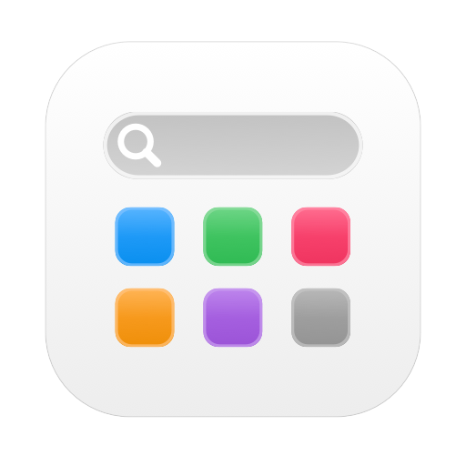
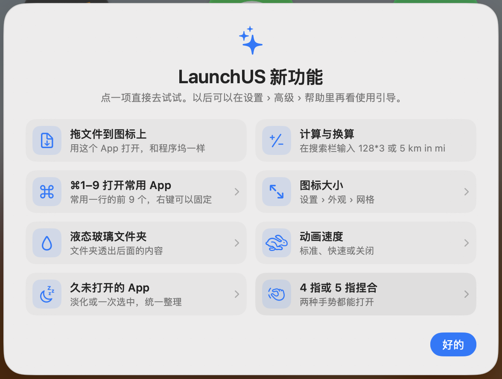

<div align="center">



# LaunchUS

**おなじみの Launchpad を macOS 26 に。ずっと無料。**

[](https://github.com/baka9981/LaunchUS/releases/latest)


[](https://github.com/baka9981/LaunchUS/releases)
[](LICENSE)
[](https://launchusapp.com/)

<a href="README.md">English</a> · <a href="README.zh-CN.md">简体中文</a> · <a href="README.zh-TW.md">繁體中文</a> · <a href="README.ja.md">日本語</a>

🌐 <a href="https://launchusapp.com/"><b>公式サイト</b></a>

 

</div>

## なぜ作ったか

macOS 26 では Launchpad が「アプリ」ウインドウに置き換わりました。LaunchUS は、ページ、フォルダ、ドラッグで並べ替え、入力して検索といったおなじみのフルスクリーングリッドを取り戻し、Launchpad になかった機能も加えます。

## 機能

| | |
|---|---|
| 🚀 **Launchpad そのまま** | ぼかし背景のフルスクリーングリッド、ページ、フォルダ、編集モード。⌥Space / F4 / トラックパッドのピンチ / ホットコーナーで開く |
| 🔎 **賢い検索** | ピンイン・頭文字、別名、`#タグ`、スマートフォルダ。計算（`128*3`）も。App が見つからないときはファイル検索、Web 検索、AI への質問も |
| ✨ **AI チャット** | 自分のゲートウェイ（OpenAI 互換または Anthropic、Ollama などのローカルモデルも可）で検索欄から会話。AI は App を探して開いたり、ホーム画面やフォルダを整理したりでき、操作の前に必ず確認します |
| 🤖 **MCP** | `LaunchUS --mcp` で Claude や Cursor などの AI ツールから App の検索・起動・終了、フォルダを開く、レイアウト切り替え |
| 📂 **ファイルをアイコンにドロップ** | Dock と同じく、ファイルを App のアイコンにドロップするとその App で開く |
| 🧩 **カスタム項目** | Web サイト、ファイル、フォルダ、スクリプトを App のように配置 |
| 🎨 **自分好みに** | アイコン変更、好きな背景画像、アイコンサイズ、アニメーション速度、ダークモード（Mac に合わせ、App 自身のダークアイコンを使用）、Liquid Glass のフォルダと検索バー、ウインドウ／フルスクリーン、行数・列数。縦向きのディスプレイではグリッドも縦に |
| 🗂 **レイアウト** | 仕事用と趣味用でページを分け、メニュー・リンク・ショートカットで切り替え |
| 🔔 **リアルタイム表示** | Dock の通知バッジ、起動中インジケータ、最近使った App の列（⌘1〜⌘9 で開く、右クリックで固定） |
| 🧹 **アンインストールと App 管理** | `~/Library` の残りファイルもまとめてゴミ箱へ。重複したコピーや削除済み App の残りを探し、Homebrew の App をその場でアップデート |
| 🕸 **長く開いていない App** | 3か月以上開いていない App を薄く表示、またはまとめて選択してフォルダへ移動・非表示 |
| 🔒 **プライバシー** | Touch ID で App を隠す、レイアウトの自動バックアップ、iCloud 同期（任意） |
| ⚡️ **ショートカットとリンク** | フォルダを開く、検索、レイアウト切り替え。`launchus://` に対応 |
| 🔄 **自動アップデート** | Sparkle による署名付きアップデート |

## インストール

1. [**LaunchUS.dmg** をダウンロード](https://dl.launchusapp.com/LaunchUS.dmg)（過去のバージョンは [Releases](https://github.com/baka9981/LaunchUS/releases)）して開き、LaunchUS を「アプリケーション」にドラッグします。
2. 初回起動時に開発元を確認できないと表示されたら、**システム設定 › プライバシーとセキュリティ** で **このまま開く** をクリックします。
3. **⌥Space** で開きます。何もないところを右クリックするか **⌘,** で設定を開きます。

macOS 26 以降が必要です。

## AI チャットと MCP

- **AI チャット**：**設定 › AI** でゲートウェイのアドレスと API キーを入力し、「取得」でモデルを選びます。検索結果がないとき **↩**（または「AI に聞く」）で会話を開始。**⇥** は Web 検索、**⌘N** は新しい会話、**Esc** で終了。背景の右クリックメニューにも「AI チャット」があります。
- **AI に LaunchUS を操作させる**：既定では検索はすぐ実行し、App を開く・移動する、フォルダを作る、レイアウトを切り替えるなどは先に確認します（この会話ではすべて許可も可）。App の終了は毎回確認します。「検索のみ」や「オフ」にもできます。
- **MCP**：Claude Code で次の行を実行します。他のクライアント用の JSON は **設定 › AI** からコピーできます。

```bash
claude mcp add launchus -- /Applications/LaunchUS.app/Contents/MacOS/LaunchUS --mcp
```

## ソースからビルド

```bash
git clone https://github.com/baka9981/LaunchUS.git
cd LaunchUS
./scripts/run.sh
```

テスト、デバッグ、リリースについては [docs/DEVELOPMENT.md](docs/DEVELOPMENT.md) を参照してください。

## プライバシー

アカウントも解析もなく、アップデートの確認と自分で設定した AI ゲートウェイ以外に通信しません。AI チャットはそのゲートウェイにだけ送られ、API キーはキーチェーンに保存されます。レイアウトは `~/Library/Application Support/LaunchUS` に保存され、他の App のデータ（システムの Launchpad データベースを含む）は読み取るだけで書き込みません。唯一の例外は、「編集…」で「Dockに追加」を押したときに、その App を Dock に追加することです。

## 無料

LaunchUS は完全に無料です。Pro 版、サブスクリプション、広告はありません。


## リンク

- [LINUX DO](https://linux.do)

## ライセンス

[MIT](LICENSE)
