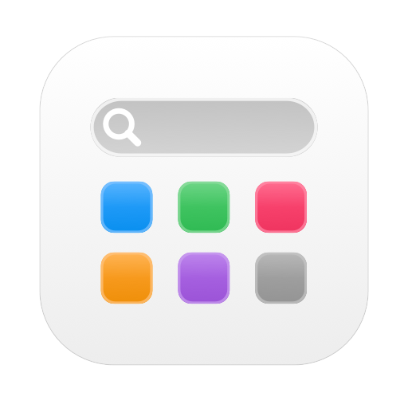
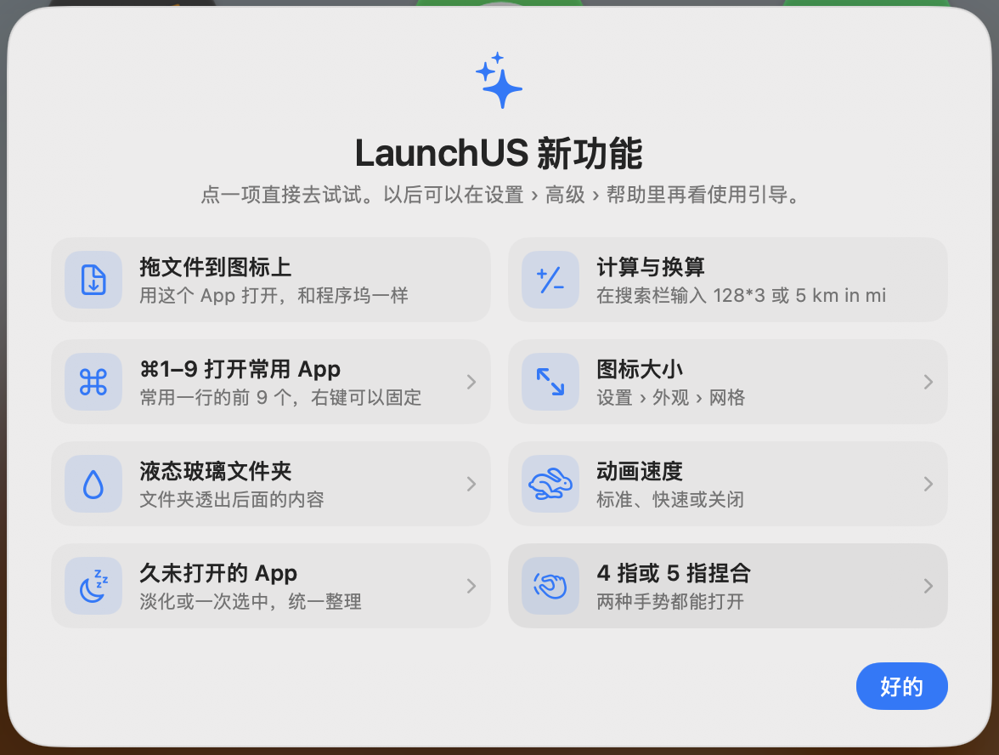

<div align="center">



# LaunchUS

**The classic Launchpad, back on macOS 26 — and free forever.**

[](https://github.com/baka9981/LaunchUS/releases/latest)


[](https://github.com/baka9981/LaunchUS/releases)
[](LICENSE)
[](https://baka9981.github.io/LaunchUS/)

<a href="README.md">English</a> · <a href="README.zh-CN.md">简体中文</a> · <a href="README.zh-TW.md">繁體中文</a> · <a href="README.ja.md">日本語</a>

🌐 <a href="https://baka9981.github.io/LaunchUS/"><b>Website</b></a>

 

</div>

## Why

macOS 26 replaced Launchpad with the Apps window. LaunchUS brings back the full-screen grid you know — pages, folders, drag to arrange, type to search — and adds what Launchpad never had.

## Features

| | |
|---|---|
| 🚀 **Feels like Launchpad** | Full-screen blurred grid, pages, folders, jiggle mode, ⌥Space / F4 / trackpad pinch / hot corner |
| 🔎 **Smarter search** | Pinyin & initials (`wx` → WeChat), aliases, `#tags`, smart folders; math (`128*3`); when no app matches, search files, the web or ask AI |
| ✨ **AI chat** | Bring your own gateway (OpenAI-compatible or Anthropic, local models like Ollama too) and chat right in the search field; the AI can find and open apps and arrange your home screen and folders, asking you before it acts |
| 🤖 **MCP** | `LaunchUS --mcp` lets Claude, Cursor and other AI tools search, open and quit apps, open folders and switch layouts |
| 📂 **Drop files on icons** | Drop files on an app icon to open them with that app, just like the Dock |
| 🧩 **Custom items** | Websites, files, folders and shell scripts that live on the grid like apps |
| 🎨 **Make it yours** | Change any icon, your own background picture, icon size, animation speed, Dark Mode (follows the Mac, with apps’ own dark icons), Liquid Glass folders and search bar, window or full-screen mode, rows & columns; the grid turns on its side on portrait displays |
| 🗂 **Layouts** | Separate pages for work and play — switch from the menu, a link or Shortcuts |
| 🔔 **Live status** | Dock badges, running indicators, a recent-apps row — ⌘1–⌘9 opens its apps, right-click to pin |
| 🧹 **Clean uninstall & app management** | Uninstalling moves the app and its `~/Library` leftovers to the Trash; find duplicate copies and leftovers of deleted apps; upgrade Homebrew apps in place |
| 🕸 **Long-unused apps** | Fade apps not opened in over 3 months, or select them all to move into a folder or hide |
| 🔒 **Private & safe** | Hide apps behind Touch ID, automatic layout backups, optional iCloud sync |
| ⚡️ **Shortcuts & links** | Open folders, search, switch layouts via Shortcuts or `launchus://` |
| 🔄 **Auto updates** | Signed updates through Sparkle |

## Install

1. Download **LaunchUS-x.y.z.dmg** from the [latest release](https://github.com/baka9981/LaunchUS/releases/latest), open it and drag LaunchUS onto **Applications**.
2. On first launch macOS may say it can’t verify the developer: open **System Settings › Privacy & Security** and click **Open Anyway**.
3. Press **⌥Space** to open. Right-click empty space or press **⌘,** for settings.

Requires macOS 26 or later.

## AI chat & MCP

- **AI chat**: in **Settings › AI**, enter your gateway address and API key, then click **Fetch** to pick a model. When a search finds nothing, press **↩** (or click **Ask AI**) to chat; **⇥** searches the web, **⌘N** starts a new chat, **Esc** leaves. Right-click empty space for **AI Chat** too.
- **Letting AI use LaunchUS**: by default look-ups run at once, while opening or moving apps, making folders, switching layouts and the like ask first (or for the whole chat); quitting an app always asks. You can switch it to look-ups only, or off.
- **MCP**: in Claude Code run the line below; the JSON for other clients is in **Settings › AI**:

```bash
claude mcp add launchus -- /Applications/LaunchUS.app/Contents/MacOS/LaunchUS --mcp
```

## Build from source

```bash
git clone https://github.com/baka9981/LaunchUS.git
cd LaunchUS
./scripts/run.sh
```

See [docs/DEVELOPMENT.md](docs/DEVELOPMENT.md) for tests, debugging and releases.

## Privacy

LaunchUS has no accounts, no analytics and no network access other than checking for updates and the AI gateway you set up yourself. AI chat goes only to that gateway, and the API key is kept in your keychain. Your layout stays in `~/Library/Application Support/LaunchUS`, and other apps’ data — including the system Launchpad database — is only ever read, never written. The one exception: clicking **Add to Dock** in **Edit…** adds that app to your Dock.

## Free

LaunchUS is completely free. No Pro tier, no subscriptions, no ads.


## License

[MIT](LICENSE)
