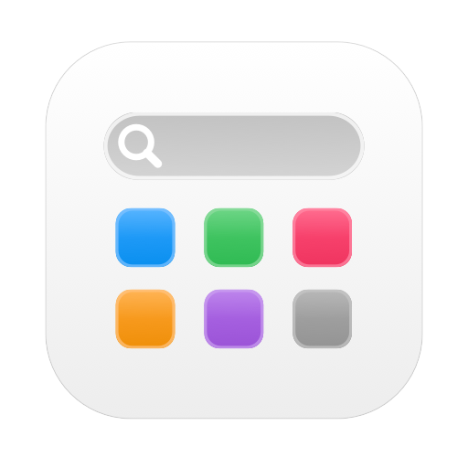
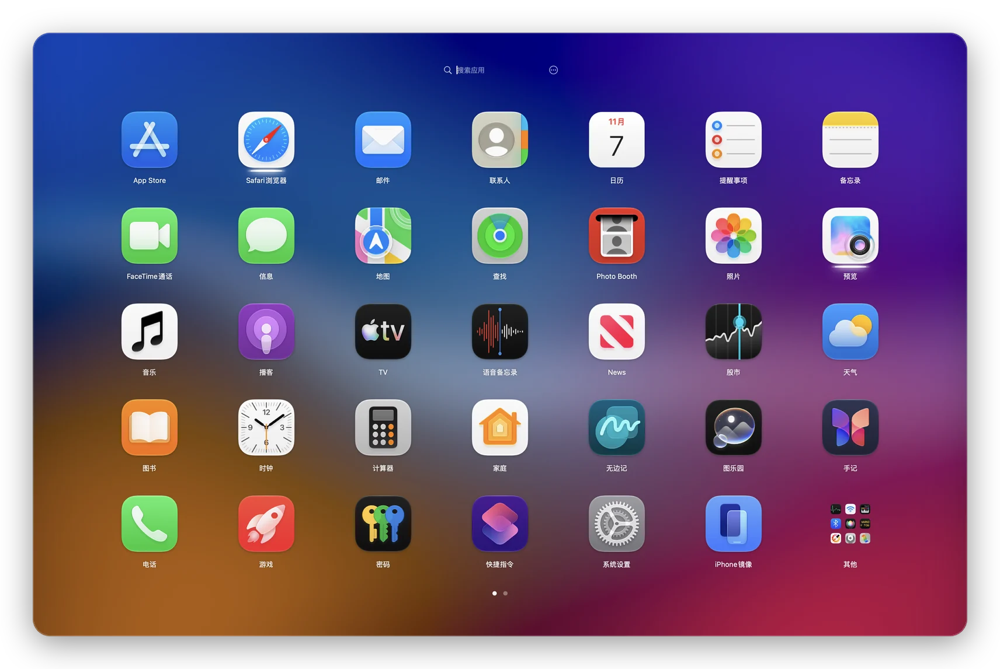

<div align="center">



# LaunchUS

**经典启动台，回到 macOS 26。永久免费。**

[](https://dl.launchusapp.com/LaunchUS.dmg)
[](https://launchusapp.com/)

[](https://github.com/baka9981/LaunchUS/releases/latest)

[](LICENSE)

<a href="README.md">English</a> · <a href="README.zh-CN.md">简体中文</a> · <a href="README.zh-TW.md">繁體中文</a> · <a href="README.ja.md">日本語</a>

</div>

<br>

<picture>
  <source media="(prefers-color-scheme: dark)" srcset="docs/images/launcher-zh-CN-dark.webp">
  
</picture>

## 为什么做它

macOS 26 用「应用程序」窗口替换了启动台。LaunchUS 把熟悉的全屏网格找回来——翻页、文件夹、拖动整理、打字搜索——再补上启动台从来没有的功能。

## 功能

| | |
|---|---|
| 🚀 **原汁原味** | 全屏模糊网格、翻页、文件夹、抖动模式；⌥Space / F4 / 触控板捏合 / 触发角唤起 |
| 🔎 **更聪明的搜索** | 拼音和首字母（`wx` → 微信）、别名、`#标签`、智能文件夹；还能算数（`128*3`）；找不到 App 时可以搜文件、搜网页或问 AI |
| ✨ **AI 聊天** | 接上自己的网关（OpenAI 兼容或 Anthropic，也可用 Ollama 等本地模型），在搜索框里直接对话；AI 能找 App、打开 App、整理主屏幕和文件夹，操作前都会先问你 |
| 🤖 **MCP** | `LaunchUS --mcp` 让 Claude、Cursor 等 AI 工具搜索、打开、退出 App，打开文件夹和切换布局 |
| 📂 **拖文件到图标上** | 和程序坞一样，把文件拖到 App 图标上就用它打开 |
| 🧩 **自定义启动项** | 网址、文件、文件夹、脚本，像 App 一样放在网格里 |
| 🎨 **按你的习惯来** | 更换任意图标、自选背景图片、图标大小、动画速度、深色模式（跟随系统，App 自带深色图标）、液态玻璃文件夹和搜索栏、窗口或全屏模式、自定义行列数；竖屏显示器上网格自动转向 |
| 🗂 **布局方案** | 工作、娱乐各一套页面，从菜单、链接或快捷指令切换 |
| 🔔 **实时状态** | 程序坞通知角标、运行指示、常用一行（⌘1–⌘9 直接打开，右键可固定） |
| 🧹 **干净卸载与 App 管理** | 卸载时连同 `~/Library` 里的残留一起移到废纸篓；找出重复的副本和已删除 App 的残留；原地升级 Homebrew 安装的 App |
| 🕸 **久未打开的 App** | 超过 3 个月没打开的 App 可以淡化，也能一次选中，统一移进文件夹或隐藏 |
| 🔒 **隐私安全** | 隐藏 App（Touch ID 验证）、自动备份布局、可选 iCloud 同步 |
| ⚡️ **快捷指令与链接** | 打开文件夹、搜索、切换布局；支持 `launchus://` |
| 🔄 **自动更新** | 通过 Sparkle 推送签名更新 |

## 安装

1. [下载 **LaunchUS.dmg**](https://dl.launchusapp.com/LaunchUS.dmg)（历史版本见 [Releases](https://github.com/baka9981/LaunchUS/releases)），打开后把 LaunchUS 拖到「应用程序」。
2. 首次打开如果提示无法验证开发者：打开 **系统设置 › 隐私与安全性**，点 **仍要打开**。
3. 按 **⌥Space** 打开。右键空白处或按 **⌘,** 进入设置。

需要 macOS 26 或更高版本。

## AI 聊天与 MCP

- **AI 聊天**：在 **设置 › AI** 里填好网关地址、API 密钥，点「获取」选模型。之后搜索没有结果时按 **↩**（或点「问 AI」）就开始对话，**⇥** 搜网页，**⌘N** 新对话，**Esc** 退出。右键空白处也有「AI 聊天」。
- **让 AI 操作 LaunchUS**：默认「操作前确认」——查询直接进行，打开 App、移动 App、建文件夹、切换布局等每次先弹出确认（可选「本次对话都允许」），退出 App 每次都要确认。也可以改成「只能查询」或「关闭」。
- **MCP**：在 Claude Code 里运行下面这行，其他客户端的 JSON 配置可在 **设置 › AI** 里复制：

```bash
claude mcp add launchus -- /Applications/LaunchUS.app/Contents/MacOS/LaunchUS --mcp
```

## 从源码构建

```bash
git clone https://github.com/baka9981/LaunchUS.git
cd LaunchUS
./scripts/run.sh
```

测试、调试与发布见 [docs/DEVELOPMENT.md](docs/DEVELOPMENT.md)。

## 隐私

没有账号、没有统计，除了检查更新和你自己配置的 AI 网关不联网。AI 聊天只发给你在设置里填的网关，API 密钥保存在钥匙串中。布局保存在 `~/Library/Application Support/LaunchUS`；其他 App 的数据（包括系统启动台数据库）只读不写；唯一的例外是你在「编辑…」里点「添加到程序坞」时，会把这个 App 加进程序坞。

## 免费

LaunchUS 完全免费：没有 Pro 版、没有订阅、没有广告。


## 友情链接

- [LINUX DO](https://linux.do)

## 许可证

[MIT](LICENSE)
