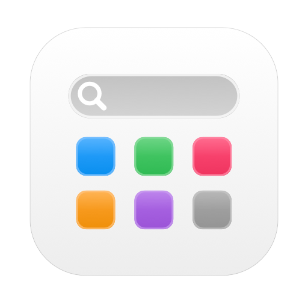
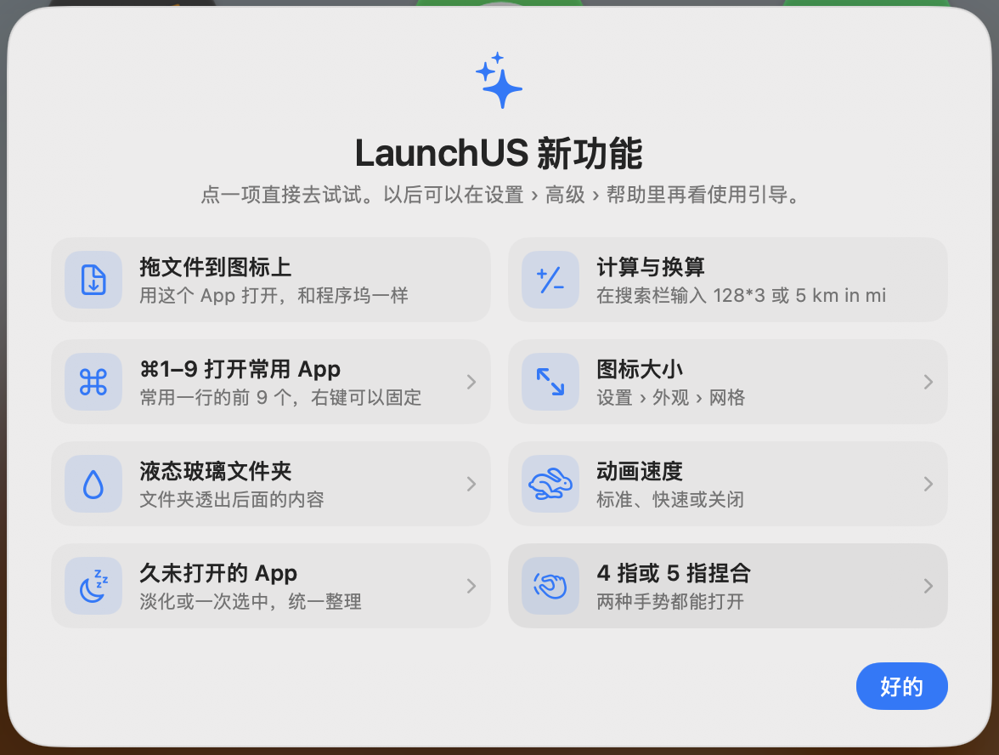

<div align="center">



# LaunchUS

**經典啟動台，回到 macOS 26。永久免費。**

[](https://github.com/baka9981/LaunchUS/releases/latest)


[](https://github.com/baka9981/LaunchUS/releases)
[](LICENSE)
[](https://launchusapp.com/)

<a href="README.md">English</a> · <a href="README.zh-CN.md">简体中文</a> · <a href="README.zh-TW.md">繁體中文</a> · <a href="README.ja.md">日本語</a>

🌐 <a href="https://launchusapp.com/"><b>官網</b></a>

 

</div>

## 為什麼做它

macOS 26 用「應用程式」視窗取代了啟動台。LaunchUS 把熟悉的全螢幕網格找回來——翻頁、檔案夾、拖動整理、打字搜尋——再補上啟動台從來沒有的功能。

## 功能

| | |
|---|---|
| 🚀 **原汁原味** | 全螢幕模糊網格、翻頁、檔案夾、抖動模式；⌥Space / F4 / 觸控板捏合 / 觸發角喚起 |
| 🔎 **更聰明的搜尋** | 拼音和首字母（`wx` → 微信）、別名、`#標籤`、智慧型資料夾；還能計算（`128*3`）；找不到 App 時可以搜檔案、搜網頁或問 AI |
| ✨ **AI 聊天** | 接上自己的閘道（OpenAI 相容或 Anthropic，也可用 Ollama 等本機模型），在搜尋框裡直接對話；AI 能找 App、打開 App、整理主螢幕和資料夾，操作前都會先問你 |
| 🤖 **MCP** | `LaunchUS --mcp` 讓 Claude、Cursor 等 AI 工具搜尋、打開、結束 App，打開資料夾和切換佈局 |
| 📂 **拖檔案到圖像上** | 和 Dock 一樣，把檔案拖到 App 圖像上就用它打開 |
| 🧩 **自訂啟動項** | 網址、檔案、檔案夾、腳本，像 App 一樣放在網格裡 |
| 🎨 **照你的習慣來** | 更換任意圖像、自選背景圖片、圖像大小、動畫速度、深色模式（跟隨系統，App 自帶深色圖像）、液態玻璃資料夾和搜尋欄、視窗或全螢幕模式、自訂行列數；直向顯示器上網格自動轉向 |
| 🗂 **佈局方案** | 工作、娛樂各一套頁面，從選單、連結或捷徑切換 |
| 🔔 **即時狀態** | Dock 通知標記、執行指示、常用一列（⌘1–⌘9 直接打開，右鍵可固定） |
| 🧹 **乾淨解除安裝與 App 管理** | 解除安裝時連同 `~/Library` 裡的殘留一起移到垃圾桶；找出重複的副本和已刪除 App 的殘留；原地升級 Homebrew 安裝的 App |
| 🕸 **久未開啓的 App** | 超過 3 個月沒打開的 App 可以淡化，也能一次選取，統一移進資料夾或隱藏 |
| 🔒 **隱私安全** | 隱藏 App（Touch ID 驗證）、自動備份佈局、可選 iCloud 同步 |
| ⚡️ **捷徑與連結** | 打開檔案夾、搜尋、切換佈局；支援 `launchus://` |
| 🔄 **自動更新** | 透過 Sparkle 推送簽署更新 |

## 安裝

1. [下載 **LaunchUS.dmg**](https://dl.launchusapp.com/LaunchUS.dmg)（歷史版本見 [Releases](https://github.com/baka9981/LaunchUS/releases)），打開後把 LaunchUS 拖到「應用程式」。
2. 首次打開如果提示無法驗證開發者：打開 **系統設定 › 隱私權與安全性**，點 **強制打開**。
3. 按 **⌥Space** 打開。右鍵空白處或按 **⌘,** 進入設定。

需要 macOS 26 或更新版本。

## AI 聊天與 MCP

- **AI 聊天**：在 **設定 › AI** 裡填好閘道位址、API 密鑰，點「取得」選模型。之後搜尋沒有結果時按 **↩**（或點「問 AI」）就開始對話，**⇥** 搜網頁，**⌘N** 新對話，**Esc** 退出。右鍵空白處也有「AI 聊天」。
- **讓 AI 操作 LaunchUS**：預設查詢直接進行，打開 App、移動 App、建資料夾、切換佈局等每次先確認（可選本次對話都允許），結束 App 每次都要確認。也可以改成「只能查詢」或「關閉」。
- **MCP**：在 Claude Code 裡執行下面這行，其他用戶端的 JSON 配置可在 **設定 › AI** 裡拷貝：

```bash
claude mcp add launchus -- /Applications/LaunchUS.app/Contents/MacOS/LaunchUS --mcp
```

## 從原始碼建置

```bash
git clone https://github.com/baka9981/LaunchUS.git
cd LaunchUS
./scripts/run.sh
```

測試、除錯與發佈見 [docs/DEVELOPMENT.md](docs/DEVELOPMENT.md)。

## 隱私

沒有帳號、沒有統計，除了檢查更新和你自己設定的 AI 閘道不連網。AI 聊天只傳給你在設定裡填的閘道，API 密鑰儲存在鑰匙圈中。佈局儲存在 `~/Library/Application Support/LaunchUS`；其他 App 的資料（包括系統啟動台資料庫）只讀不寫；唯一的例外是你在「編輯…」裡點「添加到Dock」時，會把這個 App 加進 Dock。

## 免費

LaunchUS 完全免費：沒有 Pro 版、沒有訂閱、沒有廣告。


## 授權

[MIT](LICENSE)
